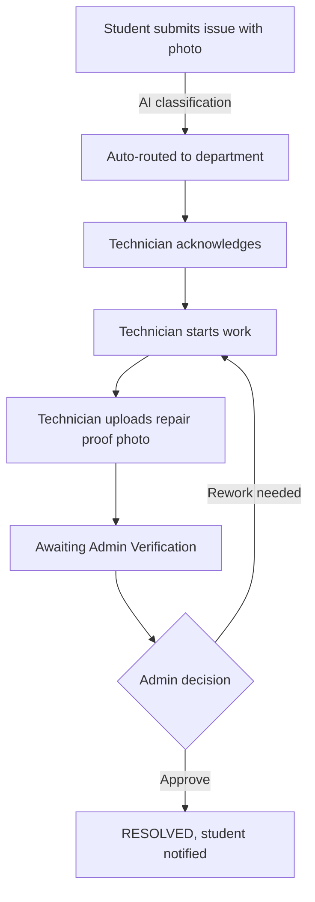

# 🌿 EcoVerse AI: Intelligent Campus Sustainability Platform

> Turn campus environmental complaints into **verified, tracked, closed-loop action**: from a student's photo report to technician repair proof to admin approval.


---

## 👀 For Judges: 2-Minute Quick Start

**Run it in 3 commands** (needs Node.js 18+; no accounts or keys required):

```bash
git clone https://github.com/vis-beep/EcoVerse.git
cd EcoVerse
npm install && npm run dev
```

Then open **http://localhost:5173** and follow the steps below.

1. On the login screen, click any of the three **one-click roles** (see below).
2. Follow the story in order: **Student → Technician → Admin**.
3. Open the **Digital Mapping** page and the floating **Copilot** (bottom-right) to see the rest.

### Suggested demo walkthrough

| Step | Role | What to do | What you'll see |
|:---:|---|---|---|
| 1 | 🎓 Student | Go to **Report** → upload any photo → submit | Photo is auto-categorised with a confidence score and routed to the right department |
| 2 | 🔧 Technician | Go to **Order of Working** → Acknowledge → Start Work → Finish Work, then upload a repair photo | Ticket moves to *Awaiting Admin Verification* |
| 3 | 🏛️ Administrator | Open **Work Inspection** → review the proof photo → **Approve** or **Request Rework** | Approved = *Resolved*; Rework sends it back to the technician |
| 4 | Any | Open **Digital Mapping** | 2D campus map with energy, bins and incident clusters |
| 5 | Any | Open the **Copilot** and click a suggested chip | Answers about live campus data (incidents, bins, energy, carbon) |

> 💡 **Cross-device sync (optional):** once Supabase is connected (see setup below), open the app on two devices, submit a report on one and watch it appear on the other via Supabase Realtime. Without Supabase, data stays in your own browser.

### Demo logins (one click, no password)

| Role | Persona | Lands on | Can do |
|---|---|---|---|
| 🎓 **Student / Faculty** | Aria Sharma | Home | Submit reports with photo evidence, track status, view dashboard |
| 🔧 **Technician** | Marcus Vance | Work Orders | Work the ticket lifecycle, upload repair-proof photos |
| 🏛️ **Administrator** | Dr. Sophia Vance | Reporting Dashboard | Approve or reject repairs, see workflow analytics, export a print/PDF report |

---

## 🎯 The Problem

On most campuses, a leaking tap, a light left on in an empty room, or an overflowing bin gets reported through scattered emails or word of mouth. Nobody can tell whether the problem was actually fixed, how long it took, or what it cost in water, power and carbon.

## 💡 Our Solution

EcoVerse is a single platform that connects everyone involved in the fix:

- **Students / faculty** report issues with a photo.
- **AI triage** classifies the issue and routes it to the right department.
- **Technicians** work the ticket and must upload **photo proof** of the repair.
- **Admins** verify the proof before anything is marked *Resolved*.
- **Digital Twin + analytics** show the campus's energy, waste and carbon picture in one place.

The key idea is **accountability**: a ticket cannot close without evidence and an admin sign-off.



---

## ✨ Features

- **Role-based workflows** for Student, Technician and Administrator, each with its own navigation and landing page.
- **Photo-evidence reporting** with AI-style auto-categorisation, confidence score and recommended action.
- **Work-order lifecycle** (Acknowledge → Start → Finish) with before/after photo proof and full audit history.
- **Admin verification** that approves or rejects repairs, with a workflow reporting dashboard and printable report.
- **2D Digital Twin** of the campus showing energy draw, smart-bin fill levels and incident hotspots.
- **EcoVerse Copilot**, a floating assistant for incident status, energy tips, waste, carbon and how-to questions.
- **Real-time multi-device sync** via Supabase (reports, work-order status, bin readings, evidence photos).
- **Light / dark theme** and a responsive mobile layout.

### 🏆 Six sustainability tracks

Reachable from the **Tracks** page (`/tracks`):

| # | Track | Focus | Route |
|:-:|---|---|---|
| 1 | Smart Waste Management | Bin fill levels, collection routes | `/tracks/smart-waste-management` |
| 2 | **AI-Powered Sustainable Campus** *(flagship)* | Incident-to-resolution loop | `/tracks/sustainable-campus` |
| 3 | Energy Monitoring & Optimisation | Building load, what-if savings | `/tracks/energy-optimization` |
| 4 | Green Building Digital Twin | Air quality, ventilation, comfort | `/tracks/green-building` |
| 5 | Carbon Footprint Intelligence | Scope 1/2/3 emissions, net-zero path | `/tracks/carbon-intelligence` |
| 6 | Smart Recycling Assistant | Recycling guidance, e-waste safety | `/tracks/smart-recycling` |

---

## ⚠️ Transparency: What Is Real vs. Simulated

We want judges to know exactly what they are looking at.

| Component | Status |
|---|---|
| Reports, work-order statuses, assignments, bin updates, evidence photos | ✅ **Real**: stored in Supabase and synced live across devices |
| Role-based UI flows and the approval workflow | ✅ **Real**: fully working in the app |
| Sensor values (kW, bin fill %, air quality), carbon savings, forecasts | 🔶 **Simulated** demo data |
| "Computer Vision" classification | 🔶 **Simulated**: a client-side demo that maps image/file hints to categories. No trained model runs yet |
| Copilot | 🔶 **Rule-based**: keyword matching over live app data. It does not call an external LLM |
| Login | 🔶 **Demo personas**: one-click roles, no real authentication |
| `backend/` FastAPI service | 🔶 **Optional reference design**: not used by the live demo |

The architecture is designed so the simulated parts can later be replaced with real IoT sensors, a trained vision model, an LLM and Supabase Auth.

---

## 🛠️ Tech Stack

| Layer | Technology |
|---|---|
| Frontend | React 18, TypeScript, Vite 5 |
| Styling | Tailwind CSS, Lucide icons |
| Charts | Recharts |
| Routing | React Router v6 |
| Cloud data | Supabase (PostgreSQL + Realtime + Storage) |
| Hosting | Vercel |
| Optional API | Python FastAPI + Pydantic (`backend/`) |

---

## 🚀 Run It Locally

**Requirements:** Node.js 18 or newer.

```bash
# 1. Clone
git clone https://github.com/vis-beep/EcoVerse.git
cd EcoVerse

# 2. Install
npm install

# 3. Start
npm run dev
```

Open **http://localhost:5173**.

**No configuration needed.** Without Supabase keys the app runs in **local-only demo mode** (data is saved in your browser), so you can try everything immediately. A yellow banner tells you this mode is active.

### Optional: enable cloud sync (Supabase)

1. Create a free project at [supabase.com](https://supabase.com).
2. In the **SQL Editor**, run everything in [`supabase/01_demo_sync.sql`](supabase/01_demo_sync.sql). This creates the tables, realtime and the evidence bucket.
3. Copy the env template and fill in your **Project URL** and **publishable key**:

   ```bash
   cp .env.example .env
   ```

   ```env
   VITE_SUPABASE_URL=https://YOUR-PROJECT.supabase.co
   VITE_SUPABASE_PUBLISHABLE_KEY=sb_publishable_YOUR_KEY
   ```

4. Restart `npm run dev`.

Full deployment steps (GitHub → Vercel → Supabase) are in [`START_HERE_SUPABASE.md`](START_HERE_SUPABASE.md).

### Build for production

```bash
npm run build
npm run preview
```

---

## 📂 Project Structure

```text
EcoVerse/
├── src/
│   ├── pages/            # Login, Home, Dashboard, Reports, WorkOrders,
│   │                     # DigitalTwin, AdminReporting, About, Tracks 1-6
│   ├── components/       # Sidebar, TopBar, FloatingCopilot, modals, Footer
│   ├── context/          # AppContext: global state, theme, Supabase sync
│   ├── data/             # Demo campus, departments and telemetry data
│   ├── lib/              # Supabase client
│   └── types/            # TypeScript models
├── supabase/             # 01_demo_sync.sql: tables, realtime, storage bucket
├── backend/              # Optional FastAPI reference service
├── public/               # Static images (campus map)
├── START_HERE_SUPABASE.md  # Deployment guide
└── vercel.json           # Vercel build config
```

---

## 🔒 Security Note

This is a **hackathon demo**. The shared database is intentionally open so judges can try it without signing up, which means anyone with the link can edit demo records. **Please do not enter real personal data or private photos.**

For production we would add Supabase Auth, role-verified row-level security, private storage buckets and server-side validation.

---

## 🗺️ Roadmap

- Replace the simulated vision step with a trained image-classification model
- Connect real IoT sensors (smart meters, bin-level sensors)
- Add Supabase Auth with verified roles and strict row-level security
- Connect the Copilot to an LLM grounded in campus data
- Push notifications for status changes

---

## 👥 Team

**Team name:** _YOUR TEAM NAME_

| Name | Role |
|---|---|
| _Your Name_ | _e.g. Full-stack developer_ |
| _Teammate_ | _e.g. UI/UX_ |

Built for **_HACKATHON / COMPETITION NAME_**.

---

## 📜 License

Released under the MIT License. See [`LICENSE`](LICENSE).

<p align="center">Built with 💚 for greener campuses.</p>
